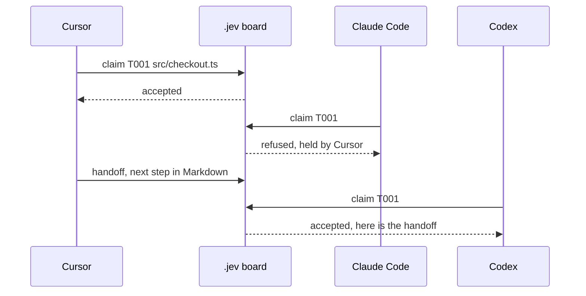

# jev-orchestrator

**Cursor claimed the file. Claude Code tried to claim it. The board said no.**

A local work board for coding agents that share one repository. Cursor, Claude Code, Codex, and Devin claim a task, leave a handoff, and stay out of each other's files.

No account. No API key. The board is a folder.

[](LICENSE)

```bash
git clone https://github.com/EdisonTKPcom/jev-orchestrator.git
cd jev-orchestrator
npm install
npm run demo
```

The demo is the whole pitch. It runs offline.

```text
One task, three agents, one file.

  add        T001  Stop the double write in checkout
             path  src/checkout.ts
  claim      cursor        accepted   T001
  claim      claude-code   refused    T001 is held by cursor
  handoff    cursor -> codex
             next  Add a file lock around the write
  claim      codex         accepted   T001
  add        T002  Cover checkout with a regression test
             path  src/checkout.ts
  claim      devin         refused    src/checkout.ts overlaps T001 held by codex
  done       codex         accepted   T001
  claim      devin         accepted   T002

Board files stayed on this machine. No account. No token.
```



## The problem

You have two coding agents open on the same bug. One is halfway through `src/checkout.ts`. The other "helps" and rewrites it. The handoff between them was a chat scrollback on a different laptop, or nothing.

What you wanted was a queue: this task, these files, who has it, what the next agent should do, and a clear no when someone else already took it.

## Use it on your repo

Node 20 or newer. From this checkout:

```bash
npm run build
npm link
cd /path/to/your/repo
jev-orchestrator init
jev-orchestrator add --title "Stop the double write" --path src/checkout.ts
jev-orchestrator claim T001 --agent cursor
```

`init` creates `.jev/` and writes the instruction files those tools already read. It will not overwrite a Cursor rule or a Devin rule that you already own.

| Tool | File | Why this file |
| --- | --- | --- |
| Codex | `AGENTS.md` | Codex loads `AGENTS.md` from the repo before it works. There is no Codex config key for the board. |
| Cursor | `AGENTS.md` and `.cursor/rules/jev-orchestrator.mdc` | Cursor reads both. The rule is `alwaysApply: true`, so the steps are in the chat. |
| Claude Code | `CLAUDE.md` starting with `@AGENTS.md` | If a `CLAUDE.md` exists, Claude Code's default is to skip `AGENTS.md` unless that file imports it. |
| Devin | `AGENTS.md` and `.devin/rules/jev-orchestrator.md` | Devin reads `AGENTS.md` (the first 16 KiB are injected automatically) and `.devin/rules` with `trigger: always_on`. |

`init` puts the shared block at the top of an existing `AGENTS.md`, because that is the part Devin injects on its own. The block is small on purpose.

## How a turn goes

1. `jev-orchestrator list` and `jev-orchestrator check --path <file>`.
2. `jev-orchestrator claim <id> --agent <you>`. A refusal means stop.
3. Do the work. On a long session, `heartbeat` extends the 30 minute lease.
4. `handoff` with what you did and what comes next, or `done`.

`check` exits 2 when a path is held, so a script can stop. `context <id>` prints the packet the next agent should read: status, holder, and the latest handoff.

```bash
jev-orchestrator handoff T001 --agent cursor --to codex \
  --done "Reproduced the double write" \
  --next "Add a file lock around the write"
```

## The board

```text
.jev/tasks.json        the queue. Commit it if another clone should see the tasks.
.jev/handoffs/T001/    Markdown the next agent reads.
.jev/claims/           local copy of the lease. Gitignored.
.jev/events.jsonl      local audit log. Gitignored. No handoff bodies.
.jev/board.lock        same-machine mutex. Gitignored.
```

A claim locks the task's paths. `src/checkout.ts` blocks another claim on that file or on `src/`. It does not block `src/checkout.ts.bak`. A task with no paths locks no files. Two agents may both *list* the same path. The second **claim** is what fails.

The lock is an exclusive file create on this machine. The full rules, the JSON shape, and the state machine are in [docs/protocol.md](docs/protocol.md).

## Commands

| Command | What it does |
| --- | --- |
| `init` | Create `.jev/` and the adapter files. `--no-adapters` skips the instruction files. |
| `add --title --path` | Queue a task. Repeat `--path` for more files. |
| `list` / `show` / `context` | Read the board. |
| `check --path` | Exit 2 if an active claim holds that path. |
| `claim` / `heartbeat` | Take or renew a lease. `--ttl 30m` (10s to 24h). |
| `status --state blocked --note` | Keep the lease, say why you are stuck. |
| `handoff --to --done --next` | Release the lease and write the packet. |
| `release` / `release --force` | Drop the lease. `--force` drops someone else's. |
| `done` | Finish the task. It stays done. |
| `demo` | Run the transcript at the top. |

Agents: `cursor`, `claude-code`, `codex`, `devin`, `generic`.

Exit codes: `0` ok, `1` bad request, `2` conflict, `3` secret rejected, `4` missing task, `5` board missing, `6` board busy.

The lock identity is the agent id plus a holder string. The default holder is `username@hostname`, so two Cursor windows on one laptop share a claim. Pass `--holder cursor-2` when two sessions of the same agent should stay apart.

## Library

```ts
import { Board, modelHintFromParts } from "@edisontkp/jev-orchestrator";

const board = new Board(process.cwd());
await board.init();
const task = await board.add({
  title: "Stop the double write",
  paths: ["src/checkout.ts"],
  modelHint: modelHintFromParts({
    source: "jev-model-router",
    tier: "frontier",
    modelId: "claude-opus-5-5",
  }),
});
await board.claim(task.id, { agent: "cursor", holder: "ada" });
```

Zero runtime dependencies. Dev installs TypeScript, tsx, and Vitest.

## Where jev-model-router fits

jev-model-router answers a different question: which model should handle this prompt. jev-orchestrator answers who is allowed to edit this task.

| | jev-orchestrator | jev-model-router |
| --- | --- | --- |
| Decision | which agent holds the task | which model should answer |
| Needs a network call | no | yes, to TypeSafe, when you route |
| Lives | in the repo, as files | in your process |

If you already route a prompt with jev-model-router, pass the result through and this board will store it:

```bash
jev-orchestrator add --title "Review the migration" --path db/migrate.ts \
  --model-source jev-model-router --model-tier frontier --model-id claude-opus-5-5
```

That flag records a choice you already made. This package does not call TypeSafe, and it does not check that the hint is true. Code still owns the lock. The hint is copied into the handoff so the next agent does not have to re-argue the model.

The split is deliberate. A lease is a fact. A model tier is a judgement. Mixing them into one service would mean the board could not run without an API key.

## v1, and what comes after

v1 is the CLI, the file protocol, path locks, handoffs, the secret scan, adapters for the four tools above, and tests.

Later, if someone needs it: a lock that works across machines, a way to sync a claim through git without a race, and maybe a typed hint for "which waiting task looks closest to this agent." None of those exist here, and the demo does not pretend they do.

## Limits

- The mutex is local. Devin on a cloud VM and Cursor on a laptop do not share `board.lock`. Commit `tasks.json` and the handoffs when the other clone should see the queue. Pull before you claim. A lost push means someone else wrote the board: read `context` and claim again.
- Instruction files are context, not a kernel. An agent can ignore them. `check` and `claim` are the enforcement, and only if the agent runs them.
- Default holder is a username and a hostname. If you commit `tasks.json`, that string is in git. Use `--holder` when you do not want that.
- The secret scan looks for a handful of token shapes. It will miss some, and `--allow-sensitive` turns it off.

## Security

There is no token in the protocol. Anyone who can write the working tree can write the board. Keep API keys, passwords, and `.env` contents out of titles, notes, and handoffs. Details are in [SECURITY.md](SECURITY.md).

## Development

```bash
npm install
npm test
npm run typecheck
make demo
```

GitHub Actions on `main` runs the typecheck, the tests, the build, and `node dist/cli.js demo` (`.github/workflows/ci.yml`).

The design notes, including why this is files and not an account, are in [docs/design.md](docs/design.md).

## Contributing

Issues and pull requests are welcome. A change to claim, handoff, or the JSON shape updates `docs/protocol.md` and the tests in the same change. Bump `protocol` only when old boards should stop loading.

Please keep the happy path offline. A network call inside `claim` or `demo` is a different product.

## License

[MIT](LICENSE). Same license as jev-model-router, so the two can sit side by side without a licence argument.
